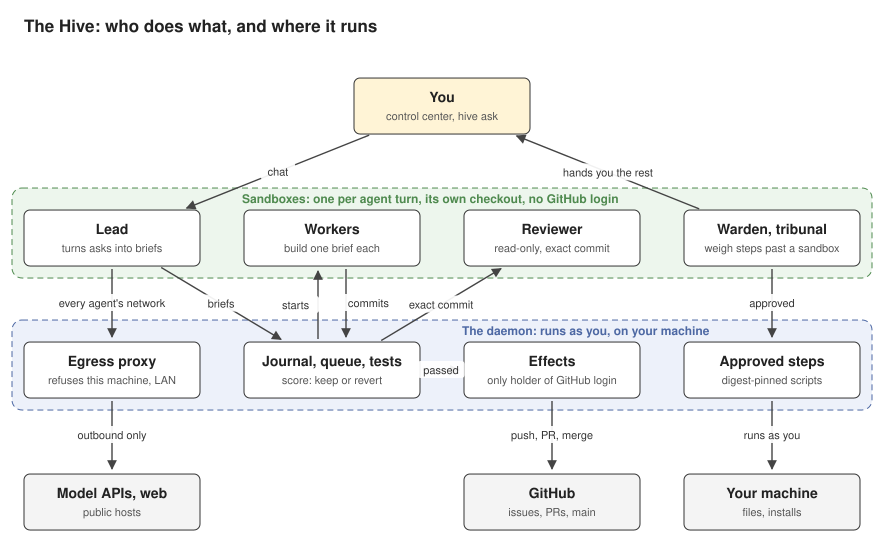

# What the Hive is

The Hive is a small team of AI agents that lives in one folder on your computer (`~/hive` by default) and works on your GitHub projects while you do other things. It is one program, `hive`, for one person on one machine. You tell it what you want in a chat; it files the work, builds it in sandboxes, tests and reviews each change, merges it on GitHub, and, where a project has a score, keeps the change only if the score didn't drop.

The diagram is drawn from [arch.json](arch.json). To change it, edit that file and run `go test ./docs -run TestArch -update`; the same test fails if the two drift apart. Every sandbox in it, agents' and tests', reaches the network only through the proxy; the arrow is drawn from the lead for room.

## Its parts

**You.** You talk to the lead in the control center (`hive`) or from a shell (`hive ask "..."`). The control center also shows what waits on you (**Waiting**), what the agents are doing, the knowledge base and the settings.

**The agents.** Each is a Claude Code session, a Codex session (so far run only against a scripted stand-in, not a real Codex login), any OpenAI-compatible model through the Hive's own agent loop ([models.md](models.md)), or a harness a module declares: the default `workers` module adds OpenCode and Cursor (Cursor not yet run for real) ([harnesses.md](harnesses.md)). Each turn runs in a sandbox of its own.

- The **lead** turns what you say into briefs, one per piece of work, and answers you.
- A **worker** takes one brief and builds it in its own checkout of the project, then commits.
- A **reviewer** reads the exact commit, with read-only tools, and says land or fix. A fix goes back to the same worker, for a few rounds at most.
- A **warden** weighs a step an agent can't take from inside its sandbox, such as installing a package. A step that is hard to undo also goes to a **tribunal**: three read-only agents, spread over models where you set more than one, who vote.
- Every agent is the same: lead, worker and sweep are names for what each was given, not ranks, and each holds the same ops on its own project (reorder or hold the queue, rerun a check, file a brief, set a task's aim, draft, ready or close the Hive's own PRs, route models), each step on the record under its run. Only the warden and tribunal (and the other check seats) are set apart.
- A **sweep** reads the records for the next real gain and files it; a **filer** tidies the knowledge base; a **module reviewer** reads a module's code before it may run.

**The daemon.** `hive` keeps a background process running (it starts with the machine). It runs as you, outside every sandbox, and does everything that needs a credential or touches the host:

- It writes every change of state to a journal (`.hive/events.jsonl`), so a restart picks up where it left off and never opens an issue, PR or run twice.
- It starts agents, queues work (as many workers and checks at once as the machine and the plan carry: the number grows while there is room and pulls back under strain, under any ceiling the person sets) and runs the tests on the exact commit in a fresh sandboxed clone, with the test command from the main branch, so a worker can neither fake a pass nor change the command.
- Its effects process is the only part that holds your GitHub login. It pushes `hive/*` branches, opens the PR and merges it pinned to the commit that was tested and read.
- After a merge it measures the project's score, if it has one, and reverts the change if the score got worse; the reason goes into `.hive/lessons.md` for later briefs.
- It runs an approved warden or tribunal step as you, as exactly the script that was approved (pinned by its digest).
- All agent traffic leaves through its egress proxy, which reaches public hosts only.

**The knowledge base.** Plain markdown in a git repository (`.hive/kb`): notes agents leave, how a Hive works, the Hive's own source, and a record of every task, run and chat filed from the journal. Agents search it before they research; you read it under **Knowledge** or with `hive kb <words>`.

**Modules.** The pipeline and the default modules (chat, work, improve, risk, knowledge base, schedules and others) are compiled into the program; their prompts are files in `.modules/` you can change. You can add modules from git. A module that carries its own program runs as you, outside the sandbox, so it starts only after a module reviewer has read its code at that exact commit, and again after every update.

## Install

**Linux only for now** ([issue #564](https://github.com/ihsan-sa/hive/issues/564)): new releases carry no macOS or Windows binary while the self-improvement loop is the focus, so the macOS and Windows installers stop with a message saying so, and macOS and Windows installs get no updates until those builds return.

macOS or Linux:

    curl -fsSL https://hive.ihsan.cc/install.sh | sh

Windows (PowerShell):

    irm https://hive.ihsan.cc/install.ps1 | iex

The installer downloads the release binary for your platform from GitHub, checks it against the release's `checksums.txt` and puts it in `~/.local/bin` (on Windows, `%LOCALAPPDATA%\Programs\hive`). No GitHub login is needed to install. Then run `hive`: the first run checks for git, Claude Code and the GitHub CLI and offers their logins, asks for a folder and a repository (Enter makes a small private demo project), sets the Hive to start with the machine and opens the control center. On Windows the agents run inside WSL 2.

`hive update` moves to the newest release, and the Hive updates itself by default. `hive shutdown` stops it; uninstalling is the same one line with `uninstall.sh` or `uninstall.ps1`. The [README](../README.md) has the rest.

## The risks, on one screen

- **The sandbox is the main wall.** On Linux and in WSL 2 each turn runs in its own Linux namespaces (bubblewrap where the system forbids plain user namespaces): it sees its checkout, a scratch home and a read-only copy of the system, and nothing of your home folder. The macOS sandbox is written but untested. Where no sandbox works, agents don't start unless you opt into bare runs, and a bare agent can do anything your account can.
- **Agents hold no GitHub login,** but each turn gets a short-lived token for its model, since Claude Code and Codex can't run without one. A turn could misuse that token while it lives.
- **The network is outbound only,** to public hosts; this machine and your LAN are refused unless you grant one local address (`hive egress grant`). An agent can still send what it can read in its sandbox to any public host, unless you narrow the list (`egress` in `.hive/config.json`).
- **Wardens run things on your machine.** At the default autonomy (2), a warden can approve a step and the daemon runs it as your user, outside any sandbox, and as root wherever `sudo` needs no password. Steps that are hard to undo need a tribunal's majority first. At autonomy 1 every such step asks you first. The pin covers the script's text, not files it calls.
- **Some things are always yours:** spending money, credentials, opening the machine to the network and anything sent in your name. The Hive spots these by reading the step's words, so it errs toward asking you, but a step that hides what it does can slip past.
- **Merges don't wait for you.** A change merges once its tests pass and a reviewer agent lands it (a small docs-only change on its tests alone). Changes to the goals, the score or the project's settings merge on a warden's read, and you're told after; at autonomy 1 they're yours to merge. Tests a worker changes as part of its change count, unless you mark their folder protected.
- **Spend isn't capped.** `monthly_usd` tells you once a month when spend passes it; it never stops work.
- **Modules with a program run as you,** unsandboxed, with only a review run between their code and your files.

More: [risk.md](risk.md) (tiers, warden, tribunal, egress), [architecture.md](architecture.md) (packages, folders, the path from ask to merge).

## Not here yet

These repeat [status.md](status.md); when it changes, this list changes with it.

- Slack, mail or phone out of the box (a module could add them), other people's workspaces on the same machine, a separate system user per agent, and sharing a GPU.
- The macOS sandbox hasn't been tested, and Codex hasn't run with a real login.
- The recursive gate ([gate.md](gate.md)), which keeps a change to the Hive itself only if a child Hive built from it does better, exists and runs on every change to the Hive's own repository taken as a gain, which is any change not clearly a fix of a named failure (a clear fix just merges, and a score dip after it files a brief to look into it rather than reverting it). It has kept its first change on merit, but no such change has yet been released and run in place of the Hive that kept it. Its verdict is not the last word: once it has measured both sides, a judge on another model weighs the numbers with the change, its brief and its worker's account, and decides; the same judge decides whether main keeps a merge whose score fell with tests green ([judge.md](judge.md)). No real model has judged yet.
